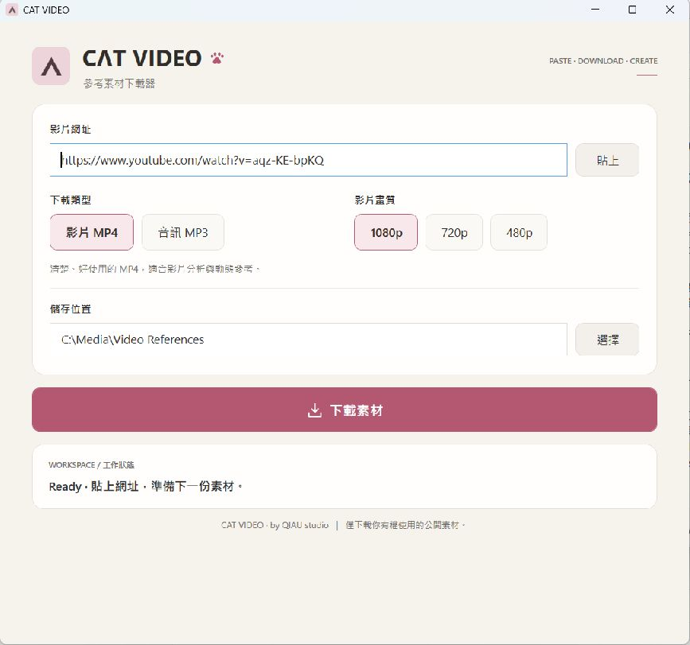

<p align="center">
  
</p>

<p align="center">
  <strong>QIAU studio</strong> 榮譽呈現
</p>

<p align="center">
  
</p>

<h1 align="center">CAT VIDEO</h1>

<p align="center">
  <strong>貼上 · 下載 · 創作 (Paste · Download · Create)</strong><br>
  專為影片分析、動作參考與創意工作流程打造的輕量級 Windows 免費參考素材下載工具。
</p>

<p align="center">
  <a href="#-免費下載-windows-版"><b>⬇️ 點此立即免費下載 Windows 版</b></a>
</p>

---

## 🎁 免費下載 (Windows 版)

CAT VIDEO 為 QIAU studio 為創作者社群提供的免費免安裝工具：

- **📦 最新發行包**：[**`CAT-VIDEO-Windows.zip`**](../../releases/latest/download/CAT-VIDEO-Windows.zip)
- **🔒 SHA256 校驗碼**：
  ```text
  d3f44b470324d5dbae8b9c4c22cf1d29443a7409c42a4ce9701f0bf2a3780bef
  ```
- **系統需求**：Windows 10 / Windows 11 (64-bit)
- **綠色設計**：解壓縮即用，免安裝、不寫入系統登錄檔、不改環境變數、不要求系統管理員權限 (UAC)。

---

## 🚀 快速上手

1. 下載 `CAT-VIDEO-Windows.zip` 並完整解壓縮至您指定的資料夾。
2. 保持資料夾結構完整，雙擊執行 **`開啟 CAT VIDEO.cmd`**（或進入 `CAT VIDEO 程式資料` 執行 `CAT VIDEO.exe`）。
3. 貼上公開影片網址，選擇 **MP4**（可選 1080p、720p 或 480p）或 **MP3**。
4. 選擇儲存位置，點擊 **下載素材** 即可。

> **💡 首次啟動說明**：  
> 為符合開源純淨標準與精簡發行體積，本發行包不內建任何編解碼器二進位檔。**首次點擊下載時，程式將自動自 Python.org、GitHub 與 PyPI 取得經 SHA256 完整性校驗之運算元件**，存放於使用者快取目錄（`%LOCALAPPDATA%\CatVideo\runtime`）。首次準備時畫面將清楚顯示進度，可隨時按取消，完成後未來即可直接下載素材。

---

## ✨ 核心特色與實測支援

- **支援多平台公開素材**：針對 YouTube、Instagram Reels、Facebook、TikTok、X (Twitter) 之公開影音素材進行過實際下載與轉換驗證。
- **標準 MP4 規格**：輸出相容性最佳的 H.264 視訊與 AAC 音訊（最高 1080p，低畫質來源保留可用解析度）。
- **一鍵 MP3 抽離**：選擇音訊模式自動抽離純音訊並轉為標準 MP3。
- **繁體中文狀態提示**：清楚呈現解析、下載進度與轉換狀態；發生錯誤時以白話中文顯示，不暴露複雜除錯堆疊。
- **安全取消與同實例恢復**：可隨時中途取消下載並自動清理暫存檔；同視窗可即刻重試，無須重開軟體。

---

## ⚠️ 使用須知與限制說明

1. **合法單支公開影片**：本工具專為創作者下載擁有合法權限或公開授權之單支參考影片設計，不支援頻道或播放清單批次抓取。
2. **登入與加密限制**：不支援需要帳號登入、付費訂閱、私人權限或 DRM 加密之內容。
3. **平台防護限制**：未內建防護繞過機制，若平台設有嚴格存取限制（如 Bilibili CDN 防盜鏈限制、特定需要登入 Cookie 之抖音影片），下載將會提示失敗。
4. **維護與授權狀態**：本工具為 QIAU studio 免費釋出之實用小工具，採一次性現狀發布。發行包內部之「待驗收」與歷史測試標記為工程驗證保留存根，不影響正常使用。

---

## 📜 授權與第三方聲明

- **CAT VIDEO 介面與核心**：依 QIAU studio Free Public Edition 規範提供。
- **隨包相依**：包含 Microsoft .NET 10.0.11 Runtime（MIT License 及 Microsoft .NET Library License）、Node.js（MIT License）。
- **執行期元件**：包含 yt-dlp (The Unlicense)、Python (PSF License)、FFmpeg (LGPLv3 Build)，詳細第三方授權條款全文與上游官方 Commit 索引請參閱隨包 `licenses/` 目錄。
